# Приложение — кейс 4 «Ситуационный центр», команда 7

Ветка сдачи: `team_7_case_4`. Прототип: C++17, `prototype/sitcenter.cpp`, запуск — `python3 04_прототип.py` или по README.

## Описание продукта

**Что это.** «Ситуационный центр» — программа для диспетчерской птицефабрики. Она следит за показаниями на пяти участках (три птичника, инкубатор, кормоцех), сама оценивает, насколько опасно каждое показание, и ведёт инциденты от появления до закрытия.

**Какую проблему решает.** Если в птичнике стало жарко или встала вентиляция, птица может погибнуть за считаные минуты. Сейчас диспетчер узнаёт об этом поздно, получает десятки одинаковых сообщений, а потом трудно понять, кто отвечал за аварию и успел ли.

**Для кого.**

|Роль|Что делает в системе|
|-|-|
|Диспетчер|видит все участки и оповещения, назначает инцидент инженеру|
|Инженер|берёт в работу инциденты только своих участков|
|Руководитель|получает эскалации (CRITICAL, STALE, просрочка), закрывает инциденты|
|Администратор|ведёт учётные записи и закрепляет участки за сотрудниками|

**Что умеет.**

* Проверяет каждую строку данных. Неизвестный участок или нечисловое значение отклоняются с кодом ошибки (`422 VALIDATION_ERROR`, `UNKNOWN_LOCATION`).
* Считает уровень опасности сам, не доверяя статусу из файла. Значение в норме, включая границу, считается NORMAL. Выход за норму до 10% даёт WARNING, больше 10% — CRITICAL. Пустое значение — это STALE: датчик молчит, и это не считается нормой.
* Не создаёт повторное оповещение, если тот же датчик снова сработал в течение 5 минут.
* При двух CRITICAL от одного датчика за 15 минут сам заводит инцидент. Инцидент назначается инженеру этого участка со сроком 1 час.
* Ведёт инцидент по статусам NEW → ASSIGNED → IN\_PROGRESS → CLOSED и проверяет права: инженер работает только в своей зоне, закрывает только руководитель, закрытый инцидент не открывается заново.
* Записывает каждое действие в журнал аудита: кто, что и когда сделал.
* Показывает всё на веб-панели диспетчера. На панели пять вкладок: обзор участков, оповещения, инциденты, сотрудники и журнал. Панель обновляется раз в 5 секунд.

**Как устроен.** Одна программа на C++17 без сторонних библиотек (`prototype/sitcenter.cpp`). На входе файлы кейса `sites.csv`, `indicators.csv`, `incidents.csv` и список сотрудников. На выходе `alerts_out.csv`, `incidents_out.csv` и `audit_log.csv`. Панель (`frontend/index.html`) только показывает эти файлы и ничего не считает сама.

**Как запустить.**

    python3 04_прототип.py                 # сборка и запуск на данных кейса, результат в out/
    bash prototype/run_tests.sh            # тесты T4-1…T4-5

**Результат на данных кейса.** Из 100 показаний программа выдала 8 CRITICAL, 14 WARNING и 2 STALE. Нашлось 6 строк с неверным статусом в исходном файле. Все 5 тестов из условия проходят.

**Ограничения прототипа.** Работа идёт на CSV-файлах кейса, без настоящих датчиков и базы данных. Подпись показаний (HMAC) и вход по паролю описаны в `11_ИБ.md` как следующий этап. STALE сейчас ставится по пустому значению, а с реальными датчиками будет ставиться по таймеру: нет данных больше 5 минут. Порог 10% взят из кейса и задан в одном месте кода.

## A. Диаграммы

Исходники всех схем — `diagrams/schemes.drawio` (открывается в draw.io), картинки — в папке `diagrams/`.

### A.1. Схема системы

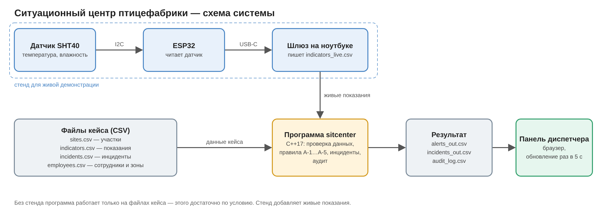

Файлы кейса (CSV) → программа sitcenter (проверка данных, правила A-1…A-5, инциденты, аудит) → выходные CSV → панель диспетчера. Реальные датчики не подключаются.

### A.2. ER-модель (6 сущностей)

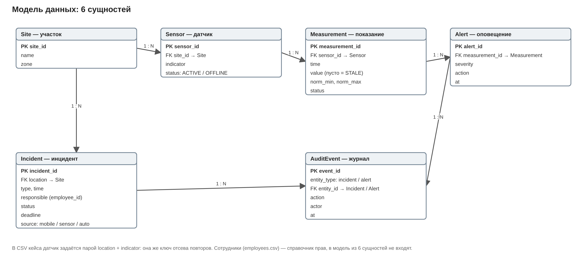

Site, Sensor, Measurement, Alert, Incident, AuditEvent; атрибуты и связи — `08_ER.md`.

### A.3. Жизненный цикл инцидента

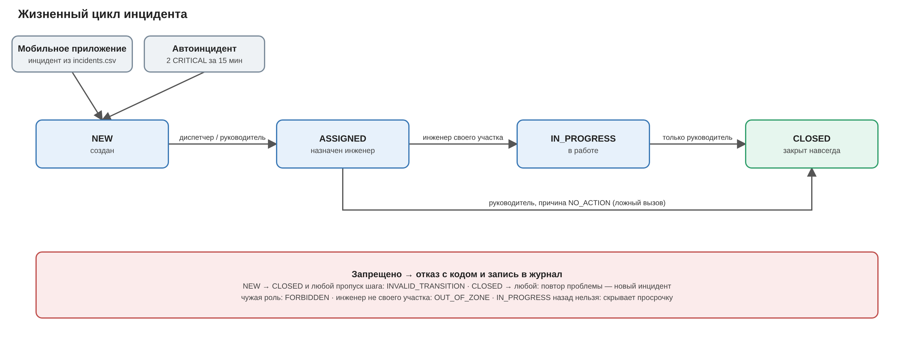

Разрешено: NEW → ASSIGNED (диспетчер или руководитель) → IN\_PROGRESS (инженер своего участка) → CLOSED (только руководитель); ASSIGNED → CLOSED — только руководитель с причиной NO\_ACTION. Запрещено: NEW → CLOSED, CLOSED → любой, откат IN\_PROGRESS назад.

### A.4. Схема потоков данных

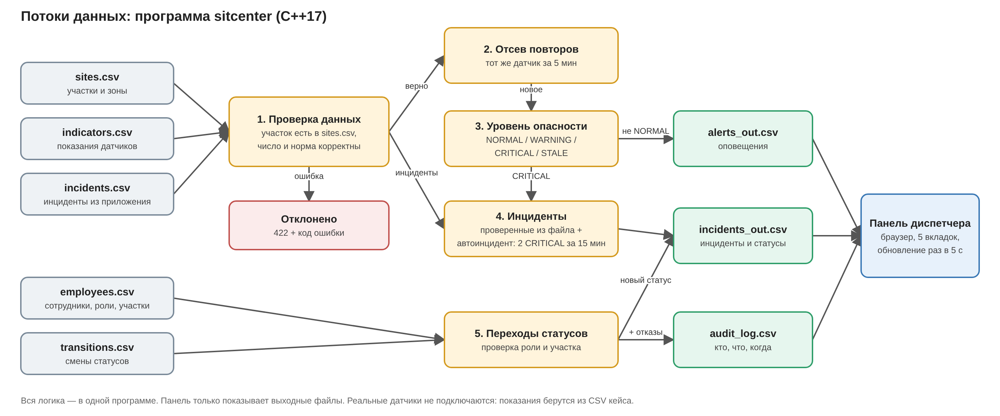

### A.5. Схема алгоритма (ГОСТ 19.701-90)

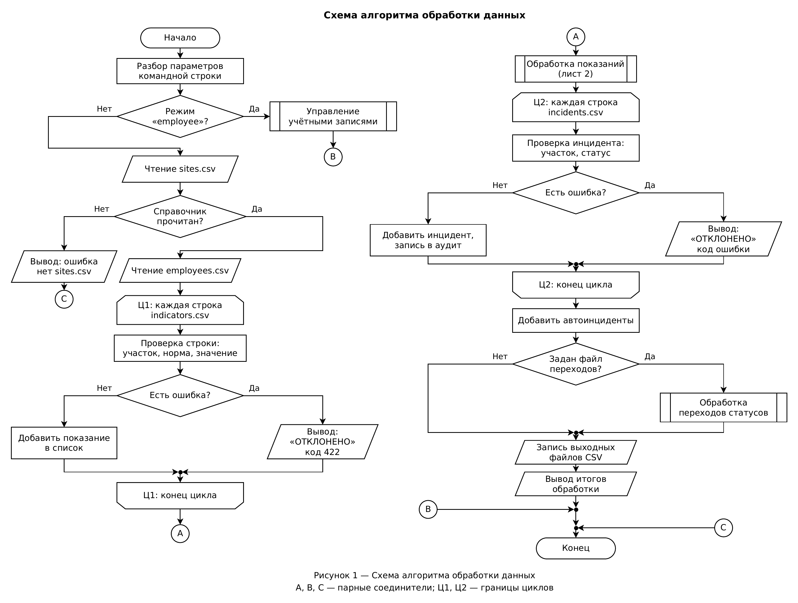

Лист 2 — подпрограмма «Обработка показаний»:

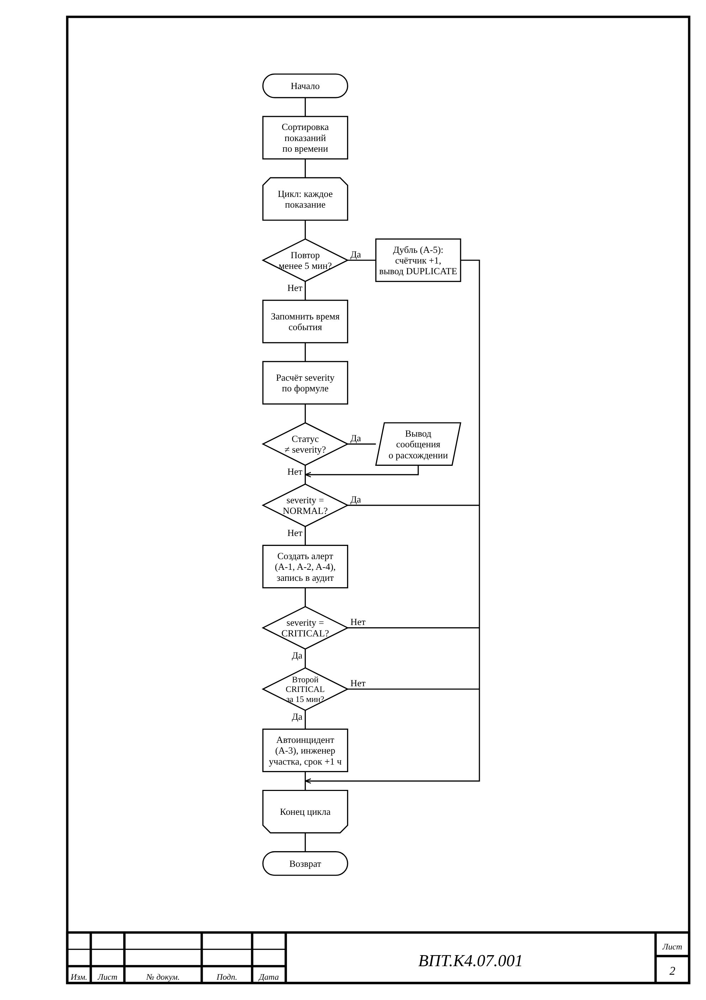

## B. Таблицы

### B.1. Правила оповещений (A-1…A-5)

|ID|Условие|Действие|severity|
|-|-|-|-|
|A-1|value < norm\_min или value > norm\_max|создать алерт|WARNING|
|A-2|отклонение > 10% от нормы|эскалировать|CRITICAL|
|A-3|2 CRITICAL подряд по одному датчику (location + indicator) в окне 15 мин|создать автоинцидент `source=auto`, назначить инженера участка, дедлайн по SLA CRITICAL (+1 ч)|CRITICAL|
|A-4|нет данных от датчика > 5 мин (`value = ""`, обрыв опроса)|создать алерт и эскалировать руководителю (`action=ESCALATED`)|STALE|
|A-5|повтор события: тот же `location + indicator` в окне 5 мин|дедуплицировать: второй алерт не создаётся, событие помечается `DUPLICATE`|— (не меняется)|

### B.2. Формула severity

```
deviation_pct = (value - norm_max) / norm_max × 100 # при превышении
или (norm_min - value) / norm_min × 100 # при недоборе
Если 0 < deviation_pct ≤ 5: severity = WARNING
Если 5 < deviation_pct ≤ 10: severity = WARNING
Если deviation_pct > 10: severity = CRITICAL
Если value = "" или нет данных: severity = STALE
Если norm_min ≤ value ≤ norm_max: severity = NORMAL (граница нормы входит в норму)
```

Порядок проверки в коде (`calc_severity`, раздел 4 `prototype/sitcenter.cpp`): сначала пустое значение → STALE, затем норма → NORMAL, затем процент отклонения.

Пример: temperature 28.3 при norm\_max 26.0 → (28.3 − 26) / 26 × 100 = 8.8% → WARNING (тест T4-2).

### B.3. SLA

|severity|Время реакции|Время закрытия|Что при просрочке|
|-|-|-|-|
|CRITICAL|15 мин|1 ч|эскалация руководителю смены, звонок/SMS дежурному инженеру|
|WARNING|1 ч|4 ч|повторное оповещение диспетчеру, при просрочке закрытия — руководителю|
|STALE|30 мин|1 ч|эскалация руководителю и инженеру КИПиА: проверка связи, питания и линии датчика|

### B.4. Роли (RBAC)

|Действие|Диспетчер|Руководитель|Инженер|Администратор|
|-|-|-|-|-|
|Создать инцидент|да|да|да|нет|
|Назначить ответственного|да|да|нет|нет|
|Сменить статус на IN\_PROGRESS|нет|нет|да (свой участок)|нет|
|Закрыть инцидент|нет|да (в т.ч. NO\_ACTION)|нет|нет|
|Переоткрыть CLOSED|нет|да, только через новый инцидент|нет|нет|
|Изменить справочник участков|нет|нет|нет|да|
|Просмотреть аудит|да|да|нет|да|

### B.5. Тесты (T4-1…T4-5)

|Тест|Что проверяет|Ожидание|Факт|Пройден|
|-|-|-|-|-|
|T4-1|Инцидент создан и назначен|NEW → ASSIGNED диспетчером; NEW → CLOSED отклонён|ASSIGNED, отказ INVALID\_TRANSITION, 2 события аудита|да|
|T4-2|Превышение порога|28.3 при norm\_max 26 → 8.8% → WARNING|WARNING, ALERT\_CREATED|да|
|T4-3|Неверные данные|инцидент с пустым или неизвестным участком → 422 UNKNOWN\_LOCATION|оба отклонены с кодом, инцидент не создан|да|
|T4-4|Повтор события|два события за 3 мин → одна запись|1 строка в alerts\_out.csv, дубль отсеян|да|
|T4-5|Датчик молчит|пустое value → STALE + эскалация, не CRITICAL|STALE, ESCALATED|да|

Прогон: `bash prototype/run_tests.sh` → «Итого: пройдено 5, не пройдено 0». Подробно — `03_тесты.md`.

### B.6. Результат на данных кейса

100 показаний: CRITICAL 8, WARNING 14, STALE 2; 6 строк с неверным статусом в файле (26.0 при norm\_max 26 помечено WARNING); 100 инцидентов принято; 124 события аудита.

## C. Журнал промптов

Инструмент: ИИ-ассистент. Формулировки запросов приведены в сжатом виде.

|Дата|Цель|Промпт (сжато)|Результат|Проверка|Использовано|
|-|-|-|-|-|-|
|2026-11-03|Декомпозиция задачи и план работ|«Проанализировать условие кейса 4 и критерии приёмки. Составить план работ по дням на период 03.11–10.11 с покрытием всех пунктов задачи»|План работ по дням, матрица «пункт задачи → артефакт», структура приложения|Сверено с критериями приёмки кейса|Да, принят как основа плана|
|2026-11-03|Схемы системы|«Разработать в draw.io три схемы: потоки данных (датчик → сервис → БД → правила → оповещения → диспетчер), ER-модель, жизненный цикл инцидента»|Файл schemes.drawio, 3 листа|Открыт в draw.io; ER-модель не соответствует шаблону 08_ER (12 сущностей вместо 6)|Частично: потоки и жизненный цикл — да, ER переделывается|
|2026-11-03|Анализ исходных данных|«Провести анализ качества данных sites.csv, incidents.csv, indicators.csv: структура, распределения статусов, аномалии и несоответствия»|6 выводов: непоследовательная граница нормы (26.0 → WARNING), порог 10% для CRITICAL, STALE = пустое значение, нет единицы вентиляции, жёсткая привязка инцидентов, несортированные строки|Подсчёт распределений скриптом по исходным файлам|Да, выводы вошли в правила и риски|
|2026-11-03|Черновик прототипа|«Реализовать консольный прототип на C++17: чтение CSV, валидация, правила оповещений, эскалация, 5 тест-сценариев»|Черновик программы и 5 тестов|Сборка g++, прогон тестов: 5 из 5 пройдено|Нет: принято решение писать код пошагово, черновик — только ориентир|
|2026-11-03|Прототип, шаг 1|«Реализовать чтение indicators.csv минимальным объёмом кода с пояснением каждой конструкции»|prototype/sitcenter.cpp, шаг 1|Сборка и запуск на данных организатора: прочитано 100 строк|Да|
|2026-11-04|Сверка с шаблонами организатора|«Сопоставить шаблоны 02–11 с текущим решением, выявить расхождения в правилах, жизненном цикле, ER и тестах»|Перечень из 5 изменений: правила A-1…A-5, запрет переоткрытия CLOSED, ER из 6 сущностей, тесты T4-1…T4-5, формат alerts_out.csv|Сверено с текстом шаблонов|Да, план скорректирован|
|2026-11-04|Репозиторий|«Подготовить структуру репозитория и ветку team_7_case_4 по требованиям чек-листа»|Ветка team_7_case_4, первый коммит со структурой|md5 indicators.csv совпадает с исходным файлом организатора|Да|
|2026-11-04|Прототип, шаг 2|«Добавить загрузку справочника sites.csv и валидацию показателей: неизвестный участок — UNKNOWN_LOCATION, нечисловое значение или норма — VALIDATION_ERROR; пустое значение пропускать для правила STALE»|Функции load_sites(), is_number(), validate()|Запуск на данных организатора (100 из 100 принято) и на 4 тестовых строках (3 отклонены с верным кодом)|Да|
|2026-11-04|Полная версия прототипа|«Реализовать прототип целиком по шаблонам организатора: формула severity (5 веток), правила A-1…A-5, жизненный цикл и RBAC, append-only аудит, выход alerts_out.csv; тесты T4-1…T4-5 и бонусный тест»|prototype/sitcenter.cpp (8 разделов), run_tests.sh, 6 тестов|Сборка g++ без предупреждений, тесты 6 из 6; проверка, что тест-раннер ловит ошибку; на данных организатора найдено 6 расхождений статуса (26.0 → WARNING в файле)|Да; код разбирается участником по разделам|
|2026-11-04|Панель диспетчера|«Разработать веб-панель диспетчера без зависимостей: KPI по уровням, карточки участков, таблицы оповещений и инцидентов с фильтрами, журнал аудита, автообновление для живой демонстрации»|frontend/index.html|Открыта в браузере на выходных файлах прототипа, ошибок в консоли нет|Да|
|2026-11-04|Заполнение протокола тестов|«Заполнить шаблон организатора 03_тесты.md фактическим выводом прототипа для T4-1…T4-5; привести формат ошибки T4-3 к контракту (422 VALIDATION_ERROR, field, code)»|03_тесты.md заполнен, добавлена функция error_text()|Прогон run_tests.sh: 6 из 6; вывод T4-3 совпадает с ожиданием шаблона|Да|
|2026-11-04|Учётные записи и зоны ответственности|«Добавить учётные записи сотрудников (роль, закреплённые участки, отключение) с управлением только администратором и журналом изменений; назначать автоинцидент инженеру участка, запрещать назначение и работу вне своей зоны; показать сотрудников и зоны в панели диспетчера»|Команды employee list/add/assign/disable, extra_data/employees.csv, accounts_log.csv, проверки OUT_OF_ZONE, раздел «Сотрудники» в панели, тест T4-7|Тесты 7 из 7; ручная проверка команд (отказ не-админу, UNKNOWN_LOCATION); панель открыта в браузере, ошибок в консоли нет|Да|
|2026-11-04|Заполнение шаблонов 02, 08, 09, 10, 11|«Заполнить шаблоны организатора (правила, ER, требования, JSON-схемы событий, ИБ) на основе подсказок шаблонов, реализованного прототипа и анализа данных; отметить решения команды; выявить и устранить расхождения документов с кодом»|5 заполненных файлов; найдено расхождение: по 11_ИБ закрывает инцидент только руководитель — код исправлен|Примеры 10_API.yaml проверены валидатором JSON Schema (draft 2020-12); тесты 7 из 7 после правки кода; пропусков «?» в шаблонах не осталось|Да, на вычитке участником|
|2026-11-04|Новый интерфейс панели диспетчера|«Переработать интерфейс панели: вкладки (обзор, оповещения, инциденты, сотрудники, аудит), текущее состояние участков по последним показаниям, лента событий, контроль SLA, фильтры, уведомление о новом CRITICAL»|frontend/index.html, новая версия|Открыта в браузере на десктопной и мобильной ширине, ошибок скриптов нет|Да|
|2026-11-05|Упрощённая схема системы|«Подготовить упрощённую схему системы: файлы кейса → программа → результат → панель»|diagrams/scheme_simple.(png, drawio); правки 08, 09, 11, панели и schemes.drawio|Сверено с кодом и панелью; тесты 7 из 7|Да|
|2026-11-05|Блок-схема по ГОСТ|«Разработать блок-схему алгоритма работы программы в соответствии с ГОСТ 19.701-90: основная программа и подпрограмма обработки показаний»|diagrams/blok_shema_gost.drawio (2 листа), blok_shema_list1.png, blok_shema_list2.png|Сверено с кодом sitcenter.cpp (main и process_readings), символы по ГОСТ 19.701-90|Да, на проверке участником|
|2026-11-05|Сверка с чек-листом сдачи|«Сверить состав репозитория и документов с чек-листом организатора, указать недостающие пункты»|Перечень недостающего: PDF 05/06, 04_прототип.py, отметки 07_чеклист, ФИО команды, уточнение дедлайна|Сверено с чек-листом организатора и содержимым ветки|Да, вошло в план на 06–08.11|
|2026-11-05|Информационная безопасность|«Объяснить, как в проекте реализованы требования 11_ИБ: роли, зоны, аудит, проверка входных данных; отделить реализованное от описанного»|Разбор мер ИБ по коду; найдена неточность: audit_log.csv пересоздаётся при каждом запуске (дописывается только в пределах запуска), accounts_log.csv — только дописывается|Сверено с кодом sitcenter.cpp (AuditLog, check_transition, validate)|Да, неточность исправлена в документах|
|2026-11-06|Разбор кода и запуск|«Подробно объяснить работу программы по разделам с фрагментами кода и дать пошаговую инструкцию сборки и запуска на macOS»|Документ «Разбор кода» (11 разделов) и инструкция: сборка g++, run_tests.sh, запуск панели через python3 -m http.server|Сборка и прогон тестов по инструкции, панель открыта в браузере|Да, на проверке участником|
|2026-11-06|Тесты по условию кейса|«Оставить в проекте только 5 тест-сценариев T4-1…T4-5, как в условии, убрать бонусные тесты и ссылки на них»|Удалены tests/T4-6 и T4-7; правки 03, 09, 11, 02, README, run_tests.sh|Прогон run_tests.sh: 5 из 5; поиск по репозиторию: ссылок на T4-6/T4-7 нет|Да|

## D. Матрица вклада

|Участник|Файлы / задачи|Часы|Подпись|
|-|-|-|-|
|Гаранин Игорь (капитан)|02\_правила.md, 09\_требования.md, 10\_API.yaml, схемы, архитектура|\_\_|\_\_\_\_\_\_|
|Хабиров Артур|prototype/sitcenter.cpp, 04\_прототип.py|\_\_|\_\_\_\_\_\_|
|Кульжанов Амир|03\_тесты.md, prototype/tests, проверка кода, 05\_презентация, 11\_ИБ.md|\_\_|\_\_\_\_\_\_|
|Медведев Даниил|frontend/ (панель), 06\_приложение, 07\_чеклист|\_\_|\_\_\_\_\_\_|

## E. Артефакты

* Git: ветка `team_7_case_4`, репозиторий `github.com/Gara00700/vpotoke-case4`.
* Данные организатора не менялись: `md5sum 01_данные/indicators.csv` = `74bef253784c98e2afbbb9a9fe910226`.
* Последний коммит ветки на момент сборки приложения:

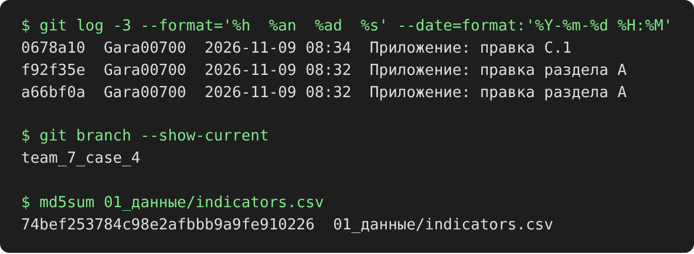

* Вывод прототипа на T4-2 (28.3 °C при норме до 26 → WARNING):

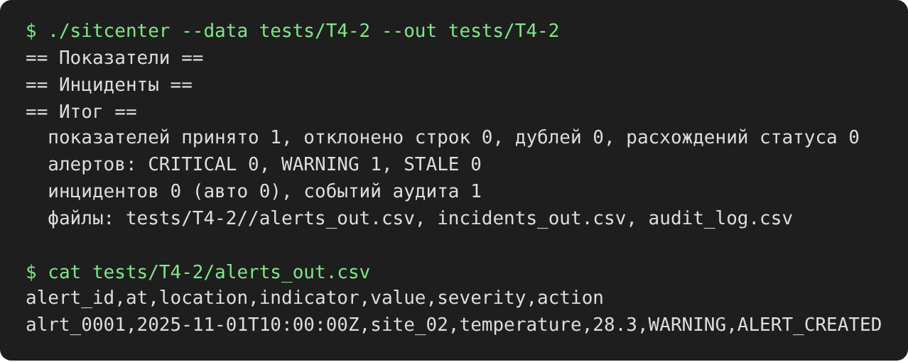

* Вывод прототипа на T4-5 (пустое значение → STALE, эскалация):

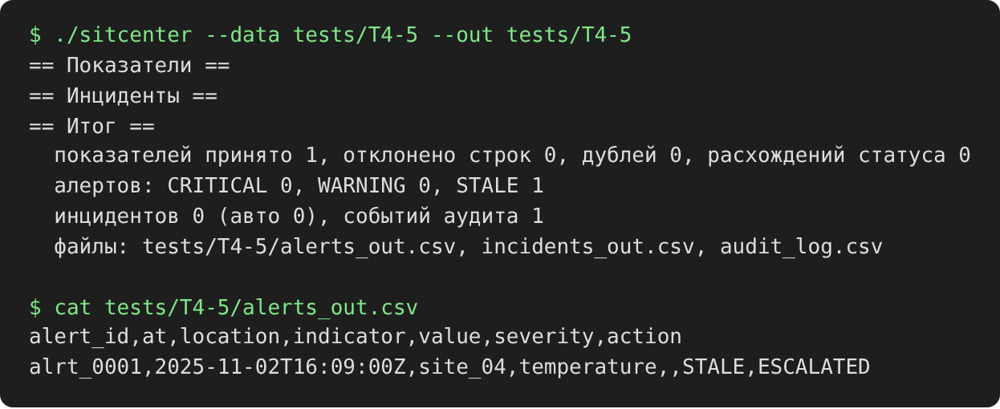

* Панель диспетчера:

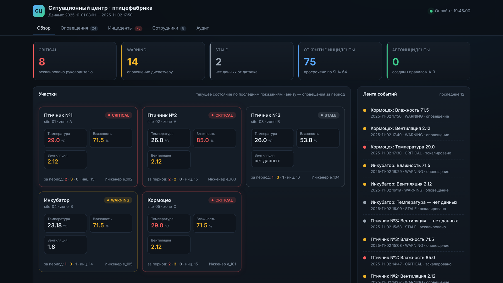

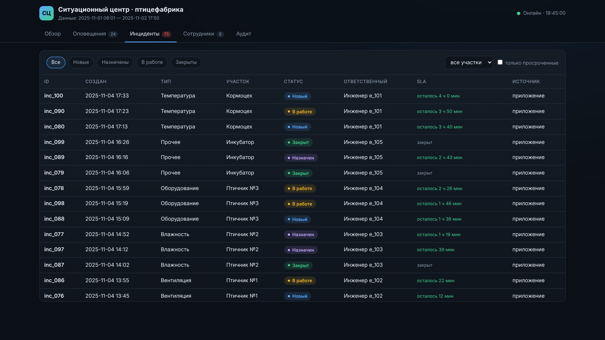

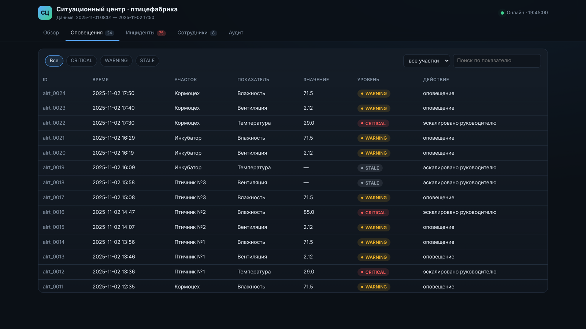

## F. Чек-лист приложения

* \[x] Описание продукта
* \[x] Схема системы (A.1)
* \[x] ER-модель (A.2)
* \[x] Жизненный цикл (A.3)
* \[x] Схема потоков (A.4)
* \[x] Правила A-1…A-5 (B.1)
* \[x] Формула severity + пример (B.2)
* \[x] SLA (B.3)
* \[x] RBAC (B.4)
* \[x] Тесты (B.5)
* \[x] Журнал промптов (C)
* \[x] Матрица вклада (D): ФИО вписаны, часы и подписи — от руки
* \[x] Git, последний коммит, вывод T4-2 и T4-5, скрины панели (E)
* \[x] Экспорт в PDF
